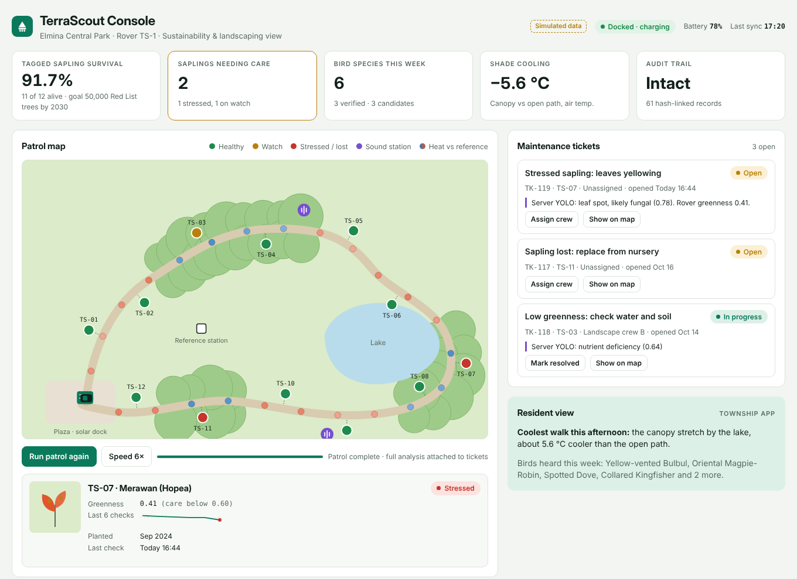
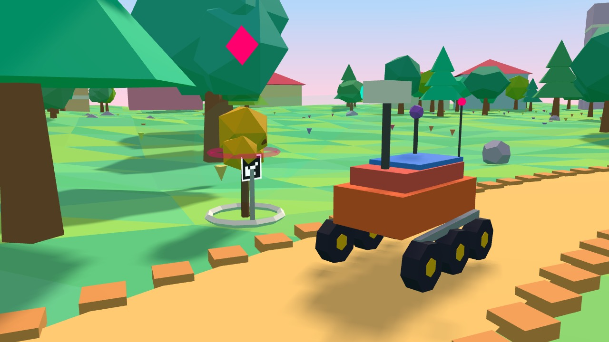
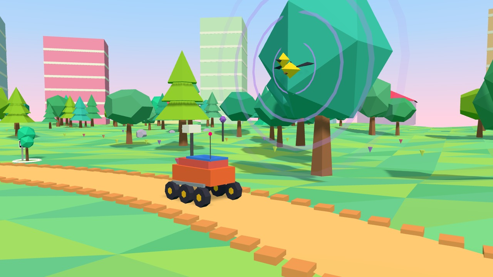
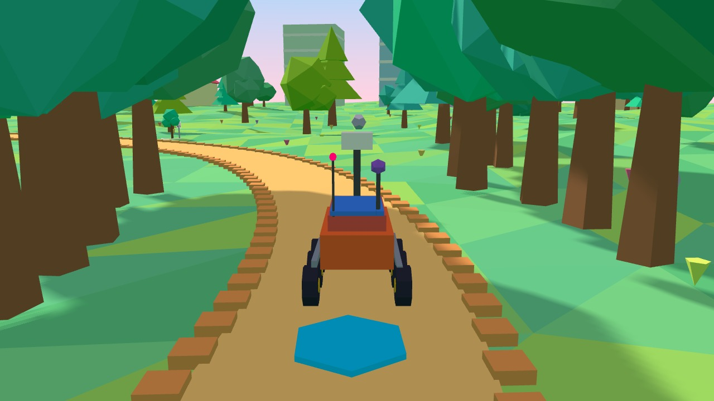

# TerraScout

**An autonomous ESG audit rover for Sime Darby Property townships.**
Sime Darby Property University Hackathon 2026 · Township of Tomorrow · Theme: Planet

TerraScout patrols township parks as a robotic ecologist. It checks each tagged sapling's leaves, identifies birds by sound and measures heat along walking paths. It then turns the results into maintenance tickets and audit-ready ESG data on one dashboard.



## How it works

1. **Patrol:** the rover follows a scheduled route from a solar dock.
2. **Sense:** camera with a printed marker on each sapling, microphone, thermal camera and air sensor.
3. **Analyse on the rover:** leaf greenness score, BirdNET bird detection, and heat compared with a fixed reference station at the same moment.
4. **Upload and verify:** photos go to a server for a larger YOLO model; every record is hash-linked in a tamper-evident audit log.
5. **Act:** tickets for landscapers, ESG indicators for the sustainability team and a shade map for residents.

| Sapling check | Listening for wildlife | Heat transect |
| --- | --- | --- |
|  |  |  |

## Repository layout

| Folder | What it holds |
| --- | --- |
| `dashboard/` | **TerraScout Console**: a single-file web dashboard (HTML, CSS, JavaScript; no build step). Patrol map, headline indicators, maintenance tickets, biodiversity, heat transect, audit trail with live SHA-256 verification, resident view, and a built-in patrol simulation. |
| `rover/` | **Rover software** (Python): greenness scoring, sensor access, patrol loop and the hash-chained audit log, with tests. Runs anywhere in simulated mode; uses real sensor drivers on a Raspberry Pi when installed. |
| `simulation/` | **3D demo** (three.js, low-poly) and the scripts that rendered the demo video: frame renderer, dashboard walkthrough capture, generated music and sound effects, and voiceover. |
| `docs/` | Screenshots used in this README. |

## Run it

### Dashboard

Open `dashboard/index.html` in any modern browser. Press **Run patrol simulation**, then try **Simulate tampering** followed by **Verify chain**.

### Rover software

```bash
cd rover
pip install -r requirements.txt
python -m terrascout_rover.patrol run --out records.jsonl     # simulated patrol, writes hash-chained records
python -m terrascout_rover.patrol verify records.jsonl        # "Chain intact: N records."
python -m terrascout_rover.patrol tamper records.jsonl 5      # edit record #5 without re-hashing
python -m terrascout_rover.patrol verify records.jsonl        # "Chain broken at record #5."
python -m pytest -q tests                                     # 5 tests
```

Thresholds (in `rover/terrascout_rover/config.py`): greenness 0.60 or above is healthy, 0.45–0.60 watch, 0.15–0.45 stressed, below 0.15 lost.

On the Raspberry Pi, install the optional drivers listed in `rover/requirements.txt` (picamera2, pupil-apriltags, MLX90640, SHT31, birdnetlib). Each sensor function falls back to simulated values when its driver is missing.

### 3D simulation and video

```bash
cd simulation
npm install                      # three.js
python3 -m http.server 8765      # in one terminal
python3 render.py                # frames/ (72 s at 30 fps); needs Playwright + Chromium
python3 clean.py                 # stills/ without overlays
python3 walk.py                  # wframes/ dashboard walkthrough
python3 audio.py                 # mix.wav: original generated music and sound effects
```

`voiceover.py` generates the narration with the open-source Kokoro model (`kokoro-onnx`); download `kokoro-v1.0.onnx` and `voices-v1.0.bin` from the kokoro-onnx releases first.

## Prototype status

| Part | Status |
| --- | --- |
| Dashboard | Working prototype with **simulated data** |
| Rover software | Working in simulated mode and tested; hardware drivers wired in but not yet tested on the physical rover |
| Full YOLO disease model | Planned: trained on nursery photos during the pilot (the prototype uses the greenness score) |
| Bird detection | BirdNET via birdnetlib; detections are candidates that an ecologist verifies |

## Hardware (prototype, about RM950–1,550)

Raspberry Pi 4/5, Pi Camera Module 3, MLX90640 thermal camera, two SHT31 temperature and humidity sensors (rover and reference station), USB microphone, GPS module, 6WD chassis with motor driver, battery pack.

## Team

[Team name] · [University]
